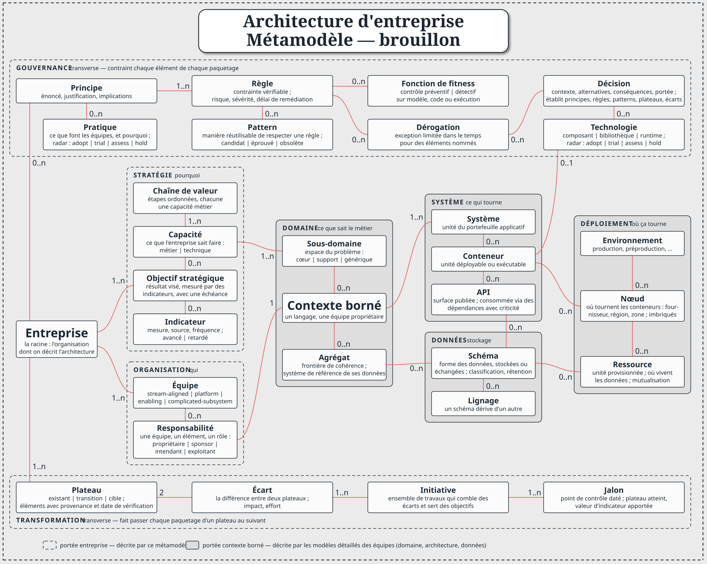

# Groupe de travail "Métamodèles et Ontologies EA"

## Pourquoi ce groupe de travail ?

Chaque équipe d'architecture décrit son organisation avec ses propres mots : capacités, applications, domaines, principes, décisions, feuilles de route… Les mêmes termes recouvrent souvent des choses différentes d'une entreprise à l'autre, d'un outil à l'autre, et parfois d'une équipe à l'autre. Les modèles qui en résultent se comparent mal, se relient mal entre eux et se vérifient difficilement.

Un **métamodèle** commun fixe ce vocabulaire : les concepts, leurs attributs et les relations qui les relient. Une **ontologie** le rend lisible par une machine. Ensemble, ils permettent :

- de **parler le même langage** entre architectes, équipes produit et équipes techniques ;
- de **relier** la stratégie (pourquoi), l'organisation (qui), les systèmes et les données (quoi) et leur évolution dans le temps (quand) ;
- de **vérifier** automatiquement des règles d'architecture, au lieu de s'en remettre uniquement aux revues ;
- d'**outiller** ces pratiques, y compris avec des agents IA, sans dépendre d'un fournisseur ou d'une notation propriétaire.

Ce groupe veut produire ce métamodèle à partir des [pratiques de la communauté](https://github.com/continuous-architecture/toolkit/tree/main/content/french/practices), et l'éprouver sur des cas concrets.

## Une première proposition de métamodèle

Pour lancer les discussions, voici un **brouillon** : huit paquetages et trente concepts. Il n'engage pas le groupe, tout est à relire et à discuter. Le texte complet est dans [metamodele-ea.md](metamodele-ea.md).

**Naviguer dans le métamodèle.** GitHub affiche le diagramme comme une image, donc ses boîtes ne sont pas cliquables ici. Le tableau ci-dessous reprend la même disposition : chaque nom mène à sa définition. Les liens des boîtes fonctionnent quand on ouvre le fichier [metamodele-ea.svg](metamodele-ea.svg) directement dans un navigateur.

<table>
  <tr>
    <td colspan="4" align="center">
      <b><a href="metamodele-ea.md#paquetage-gouvernance">GOUVERNANCE</a></b> · transverse, contraint chaque élément de chaque paquetage 
      <a href="metamodele-ea.md#principe">Principe</a> ·
      <a href="metamodele-ea.md#règle">Règle</a> ·
      <a href="metamodele-ea.md#fonction-de-fitness">Fonction de fitness</a> ·
      <a href="metamodele-ea.md#décision">Décision</a> 
      <a href="metamodele-ea.md#pratique">Pratique</a> ·
      <a href="metamodele-ea.md#pattern">Pattern</a> ·
      <a href="metamodele-ea.md#dérogation">Dérogation</a> ·
      <a href="metamodele-ea.md#technologie">Technologie</a>
    </td>
  </tr>
  <tr>
    <td valign="top">
      <a href="metamodele-ea.md#entreprise"><b>Entreprise</b></a> (racine)  
      <b><a href="metamodele-ea.md#paquetage-stratégie">STRATÉGIE</a></b> · pourquoi 
      <a href="metamodele-ea.md#chaîne-de-valeur">Chaîne de valeur</a> 
      <a href="metamodele-ea.md#capacité">Capacité</a> 
      <a href="metamodele-ea.md#objectif-stratégique">Objectif stratégique</a> 
      <a href="metamodele-ea.md#indicateur">Indicateur</a>  
      <b><a href="metamodele-ea.md#paquetage-organisation">ORGANISATION</a></b> · qui 
      <a href="metamodele-ea.md#équipe">Équipe</a> 
      <a href="metamodele-ea.md#responsabilité">Responsabilité</a>
    </td>
    <td valign="top">
      <b><a href="metamodele-ea.md#paquetage-domaine">DOMAINE</a></b> · ce que sait le métier 
      <a href="metamodele-ea.md#sous-domaine">Sous-domaine</a> 
      <a href="metamodele-ea.md#contexte-borné">Contexte borné</a> 
      <a href="metamodele-ea.md#agrégat">Agrégat</a>
    </td>
    <td valign="top">
      <b><a href="metamodele-ea.md#paquetage-système">SYSTÈME</a></b> · ce qui tourne 
      <a href="metamodele-ea.md#système">Système</a> 
      <a href="metamodele-ea.md#conteneur">Conteneur</a> 
      <a href="metamodele-ea.md#api">API</a>  
      <b><a href="metamodele-ea.md#paquetage-données">DONNÉES</a></b> · stockage 
      <a href="metamodele-ea.md#schéma">Schéma</a> 
      <a href="metamodele-ea.md#lignage">Lignage</a>
    </td>
    <td valign="top">
      <b><a href="metamodele-ea.md#paquetage-déploiement">DÉPLOIEMENT</a></b> · où ça tourne 
      <a href="metamodele-ea.md#environnement">Environnement</a> 
      <a href="metamodele-ea.md#nœud">Nœud</a> 
      <a href="metamodele-ea.md#ressource">Ressource</a>
    </td>
  </tr>
  <tr>
    <td colspan="4" align="center">
      <b><a href="metamodele-ea.md#paquetage-transformation">TRANSFORMATION</a></b> · transverse, fait passer chaque paquetage d'un plateau au suivant 
      <a href="metamodele-ea.md#plateau">Plateau</a> ·
      <a href="metamodele-ea.md#écart">Écart</a> ·
      <a href="metamodele-ea.md#initiative">Initiative</a> ·
      <a href="metamodele-ea.md#jalon">Jalon</a>
    </td>
  </tr>
</table>

Pour aller plus loin dans le document : [ce que le métamodèle n'est pas](metamodele-ea.md#ce-que-ce-métamodèle-nest-pas), [les contrôles qu'il rend possibles](metamodele-ea.md#contrôles-rendus-possibles), [la correspondance avec ArchiMate](metamodele-ea.md#correspondance-avec-archimate), [un exemple complet](metamodele-ea.md#exemple--lendwell-un-prêteur-fictif), [la piste d'une ontologie](metamodele-ea.md#vers-une-ontologie) et [les questions ouvertes](metamodele-ea.md#questions-ouvertes).

## Objectif

- Produire un métamodèle d'architecture d'entreprise de référence avec les concepts manipulés par nos [pratiques](https://github.com/continuous-architecture/toolkit/tree/main/content/french/practices)
- Ce métamodèle doit servir des cas d'usages explicites
- Une ou plusieurs études de cas permettront d'évaluer sa pertinence et de le mettre en pratique
- Fournir ces résultats pour début février avec présentation à la communauté

## Étapes

- [x] Rédiger une première proposition de métamodèle ([metamodele-ea.md](metamodele-ea.md))
- [ ] Relire la proposition et lister les désaccords
- [ ] Choisir les cas d'usage que le métamodèle doit servir (À confirmer)
- [ ] Mener une ou plusieurs études de cas (À confirmer)
- [ ] Présenter les résultats à la communauté, début février

## Fonctionnement du groupe

- Une réunion hebdo via Teams tous les vendredi de 10h à 11h
- Toute la production sera dans ce repo git dans le répertoire `projets/metamodeles`
- Échanges asynchrones : sur le slack avec un channel dédié et/ou un groupe Whatsapp dédié 

## Participants

- [Jérémie Grodziski](mailto:jeremie@defsquare.com): Lead du groupe
