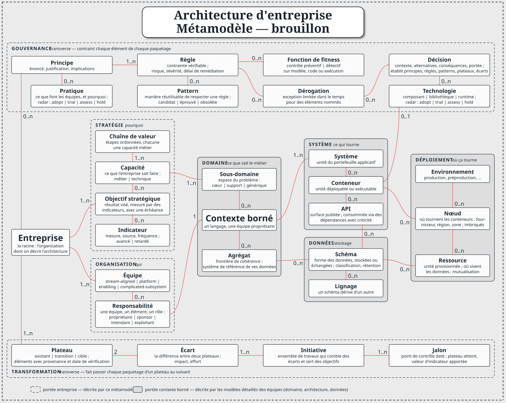

# Métamodèle d'architecture d'entreprise — première proposition

> **Statut : brouillon de travail.** Ce document est une proposition de départ pour le groupe de travail. Il n'engage ni le groupe ni la communauté : aucune décision n'a encore été prise sur son contenu. Les points à trancher sont listés dans [Questions ouvertes](#questions-ouvertes).

## Objectif

Proposer une première version d'un métamodèle d'architecture d'entreprise : les concepts nécessaires pour décrire l'architecture d'une organisation dans son ensemble. Le métamodèle doit dire pourquoi l'organisation investit, qui est responsable de quoi, quelles règles s'appliquent partout et comment le paysage passe de son état actuel à un état cible.

Ce texte est indépendant de tout outil et de toute notation. Il sert de base de discussion pour le groupe : chaque concept, chaque relation et chaque contrôle peut être relu, contesté, renommé ou retiré.

**Origine.** La proposition reprend, sous une forme neutre et traduite, le brouillon de métamodèle d'architecture d'entreprise du projet open source [Specy](https://specy.ai) (version de novembre 2026). Les éléments propres à Specy (formats de fichiers, syntaxe, outillage) ont été retirés.

## Étapes

- [x] Rédiger une première proposition, indépendante de tout outil (ce document)
- [ ] Relire la proposition en groupe et noter les désaccords dans les [questions ouvertes](#questions-ouvertes)
- [ ] Confronter les concepts aux [pratiques de la communauté](https://github.com/continuous-architecture/toolkit/tree/main/content/french/practices)
- [ ] Choisir les cas d'usage que le métamodèle doit servir (À confirmer)
- [ ] Éprouver le métamodèle sur une ou plusieurs études de cas (À confirmer)
- [ ] Décider de la forme de l'ontologie, si le groupe en veut une (voir [Vers une ontologie](#vers-une-ontologie))

## Pourquoi un métamodèle à l'échelle de l'entreprise ?

Les modèles qu'utilisent les équipes décrivent chacun une chose en profondeur : un domaine métier, un système, ses données, son déploiement. Ils travaillent à l'échelle d'un **contexte borné** (*bounded context*) : un modèle, un langage, une équipe. Une cartographie applicative va un cran plus haut : elle montre les systèmes de l'organisation, ce dont chacun est la référence et qui dépend de qui. Mais elle ne dit rien de la raison d'être de ces systèmes ni de qui en répond.

Aucun de ces modèles ne répond aux questions qui n'apparaissent que lorsqu'il y en a beaucoup. Quelle capacité ce contexte sert-il ? Quelle équipe en est propriétaire ? A-t-il le droit d'appeler cet autre système de manière synchrone ? Qu'est-ce qui le remplace l'an prochain ?

Ce métamodèle ajoute cette **portée entreprise**. Il le fait en **enveloppant** les modèles existants au lieu de les décrire une seconde fois. Il définit huit paquetages :

| Paquetage | Portée | Répond à | Concepts | Décrit par |
|---|---|---|---|---|
| [Stratégie](#paquetage-stratégie) | entreprise | pourquoi, et comment on le mesure | Objectif stratégique, Capacité, Chaîne de valeur, Indicateur | ce métamodèle |
| [Organisation](#paquetage-organisation) | entreprise | qui | Équipe, Responsabilité | ce métamodèle |
| [Domaine](#paquetage-domaine) | contexte borné | ce que sait le métier | Sous-domaine, Contexte borné, Agrégat | le modèle de domaine (DDD) |
| [Système](#paquetage-système) | contexte borné | ce qui tourne | Système, Conteneur, API | la cartographie applicative et le modèle d'architecture (type C4) |
| [Données](#paquetage-données) | contexte borné | ce qui est stocké et où cela circule | Schéma, Lignage | le modèle de données |
| [Déploiement](#paquetage-déploiement) | contexte borné | où cela tourne | Environnement, Nœud, Ressource | le modèle de déploiement |
| [Gouvernance](#paquetage-gouvernance) | entreprise, transverse | ce qui doit être vrai, et comment s'y conformer | Principe, Règle, Fonction de fitness, Pattern, Décision, Dérogation, Technologie, Pratique | ce métamodèle |
| [Transformation](#paquetage-transformation) | entreprise, transverse | ce qui change, et quand | Plateau, Écart, Initiative, Jalon | ce métamodèle |

Stratégie, Organisation, Domaine, Système, Données et Déploiement forment une chaîne. La stratégie et l'organisation donnent à un contexte borné sa raison d'être et son propriétaire. Le domaine est réalisé par des systèmes et des données, et les deux sont déployés. Gouvernance et Transformation sont **transverses** : une règle peut contraindre un élément de n'importe quel paquetage, et un plateau peut contenir des éléments de tous les paquetages. Avec la racine [Entreprise](#entreprise), les huit paquetages comptent trente concepts.

La proposition emprunte à ArchiMate (objectif, principe, capacité, chaîne de valeur, plateau, écart), à Team Topologies (types d'équipes), à l'architecture évolutive (fonctions de fitness), aux *Architecture Decision Records*, au *Technology Radar* de Thoughtworks (ses quatre anneaux) et au livre de Tanusree McCabe, *Fundamentals of Enterprise Architecture* (patterns et standards technologiques, anatomie d'une décision, indicateurs). Elle est volontairement plus petite que chacune de ces sources (voir [Correspondance avec ArchiMate](#correspondance-avec-archimate)).

## Ce que ce métamodèle n'est pas

- **Pas une seconde description** du domaine, des systèmes ou des données. Les quatre paquetages de portée contexte borné nomment des concepts qui vivent dans les modèles détaillés des équipes. Ils n'ajoutent que ce qui se voit d'en haut : la capacité servie par un élément, qui en est propriétaire et qui le finance, la sensibilité de ses données, les règles qui le contraignent et les plateaux où il existe. Un modèle d'entreprise qui recopie les champs d'un agrégat, ou qui liste un système absent de la cartographie applicative, est faux par construction.
- **Pas ArchiMate.** Il n'y a pas de couche processus métier (une chaîne de valeur est une liste ordonnée de capacités, pas un processus), pas de vocabulaire acteur/rôle/collaboration et pas d'algèbre générique de relations (*serving*, *triggering*, *flow*, *access*…). Chaque relation porte un nom et un seul sens.
- **Pas un outil de gestion de portefeuille ou de projet.** Une initiative porte ce qui explique un changement d'architecture (les écarts qu'elle comble, les objectifs qu'elle sert, ses jalons), pas les budgets, les effectifs ou le découpage en tâches.
- **Pas un organigramme.** Les équipes apparaissent comme propriétaires d'éléments. Les liens hiérarchiques, les effectifs et les personnes sont hors du périmètre.
- **Pas une CMDB.** Le déploiement enregistre les faits de placement et de localisation dont les règles d'architecture ont besoin. Il n'inventorie pas chaque instance en fonctionnement.

## Conventions

Chaque concept porte un **nom**, une **description** et des **métadonnées** (des paires clé/valeur libres). Ces attributs sont implicites et ne sont pas répétés dans les définitions.

Les métadonnées servent à ce qui n'a pas encore d'attribut. Un attribut lu par une règle doit être déclaré sur son concept, avec son but, le cycle de vie de sa valeur et les règles de qualité qu'il respecte. La gouvernance repose sur les attributs : une règle portant sur une clé libre vérifie une valeur que personne ne s'est engagé à tenir à jour.

**Portées.** Un concept est soit de *portée entreprise* (il existe une fois pour toute l'entreprise et traverse les contextes bornés), soit de *portée contexte borné* (il appartient à un contexte borné et il est décrit par un modèle détaillé). Le tableau des paquetages donne la portée de chacun.

**Références à un élément.** Les concepts de Gouvernance et de Transformation, ainsi que la Responsabilité, pointent vers « un élément » : n'importe quel concept nommé de n'importe quel paquetage, y compris les concepts des modèles détaillés (un module, un composant, un connecteur, une structure de données, une dépendance ou un flux de la cartographie applicative). Un élément est référencé, jamais recopié.

**Correspondance implicite par le nom.** Une référence de portée entreprise vers un concept de portée contexte borné se résout par le nom. L'entreprise est l'organisation décrite par les modèles de domaine et la cartographie applicative. Un sous-domaine ou un contexte borné nommé ici est celui du modèle de domaine qui porte le même nom. Un système est celui de la cartographie applicative qui porte le même nom. Une technologie est celle que nomme le champ « technologie » des modèles. Une référence explicite n'est nécessaire que lorsque les noms divergent.

**Identifiants stables.** Les concepts de gouvernance et de transformation que d'autres documents citent portent un identifiant unique et stable. L'identifiant ne change jamais quand l'élément est renommé, et il n'est jamais réutilisé :

- **Principe** : `PRIN-NNN`
- **Règle** : `REG-NNN`
- **Pattern** : `PAT-NNN`
- **Pratique** : `PRA-NNN`
- **Décision** : `ADR-NNN`
- **Dérogation** : `DER-NNN`
- **Initiative** : `INIT-NNN`

## Entreprise

La racine du modèle : l'organisation dont on décrit l'architecture. C'est la même organisation que celle des modèles de domaine et de la cartographie applicative, vue avec tout ce qui entoure ses contextes bornés et ses systèmes. Chaque correspondance vaut dès que le modèle correspondant existe : une cartographie applicative est souvent dressée avant tout modèle de domaine, et une carte des capacités avant l'une comme l'autre.

Relations :
- 0..1 « correspond à » une organisation décrite par les modèles de domaine
- 0..1 « correspond à » une organisation décrite par la cartographie applicative
- 1..n « poursuit » des objectifs stratégiques
- 1..n « possède » des capacités (la carte des capacités)
- 0..n « possède » des chaînes de valeur
- 0..n « suit » des indicateurs
- 1..n « est composée de » équipes
- 0..n « adopte » des principes
- 0..n « publie » des patterns
- 0..n « catalogue » des technologies
- 0..n « adopte » des pratiques (quel que soit leur anneau)
- 0..n « consigne » des décisions
- 1..n « est décrite par » des plateaux (au moins l'existant)

---

## Paquetage Stratégie

La stratégie dit ce que l'entreprise cherche à atteindre, ce qu'elle doit savoir faire pour y arriver et comment elle saura qu'elle y est arrivée. C'est la raison d'être de tous les autres éléments : un élément qu'on ne peut rattacher à aucune capacité ni à aucun objectif est candidat au retrait.

### Objectif stratégique

Un résultat que l'entreprise poursuit, énoncé de façon à pouvoir juger s'il est atteint.

Un objectif stratégique a :
- **énoncé** : le résultat, mesurable (par exemple « Décider 80 % des demandes de crédit à la consommation en moins de dix minutes »).
- **échéance** : la date ou la période à laquelle il doit être atteint.

Un objectif est mesuré par un ou plusieurs [indicateurs](#indicateur), chacun avec une **valeur de départ** (la valeur de l'indicateur quand l'objectif a été fixé, avec la date de la mesure) et une **valeur cible** à atteindre à l'échéance. Lu comme un OKR, l'objectif est l'*objective* et chaque indicateur, avec son départ et sa cible, est un *key result*. Une cible seule dit où arriver, pas le chemin qui reste : sans valeur de départ, la contribution d'un jalon ne peut pas se lire comme un progrès. Un objectif découpé en sous-objectifs peut être jugé à travers eux ; tout autre objectif a au moins une mesure.

Un objectif a un propriétaire, comme tout élément de la stratégie : l'équipe qui répond de son atteinte. Les initiatives qui le servent ont leurs propres propriétaires.

Un objectif d'entreprise n'est pas un objectif produit. Un objectif produit appartient à un produit ; un objectif d'entreprise traverse les produits, et les objectifs produits y **contribuent**.

Relations :
- 0..n « découpé en » sous-objectifs
- 0..n « mesuré par » des indicateurs, chacun avec une valeur de départ et une valeur cible (un *key result*)
- 0..n « requiert » des capacités (celles dont la création ou l'amélioration conditionne l'objectif)
- 0..n « reçoit la contribution de » objectifs produits
- 0..n « servi par » des initiatives
- 0..1 « a pour propriétaire » une équipe (via une responsabilité)

### Capacité

Ce que l'entreprise est capable de faire, nommé indépendamment de la façon de le faire, de qui le fait et du système utilisé (« Octroyer un crédit », « Encaisser un paiement »). Les capacités sont stables : les équipes se réorganisent et les systèmes sont remplacés bien plus souvent qu'une capacité n'apparaît ou ne disparaît. Cette stabilité fait de la carte des capacités le point d'ancrage de tout ce qui se trouve en dessous.

Une capacité a une **nature** :

| Nature | Sens | Réalisée par |
|---|---|---|
| `métier` | ce que fait l'entreprise, pour ses clients ou pour elle-même (« Octroyer un crédit ») | des sous-domaines : les parties de l'espace du problème où elle se situe |
| `technique` | ce que la plateforme fait pour les systèmes (« Envoyer une notification », « Faire monter un service en charge automatiquement », « Superviser un service ») | des systèmes, directement, en général détenus par une équipe `platform` |

Une capacité technique n'est pas une zone du métier : elle ne passe donc pas par un sous-domaine. L'enregistrer comme sous-domaine `générique` cacherait ce que fournit une équipe plateforme derrière le vocabulaire de l'espace du problème.

Les capacités se décomposent en arbre, en général sur deux ou trois niveaux, et une capacité se décompose en capacités de même nature. Seules les capacités feuilles sont réalisées.

Relations :
- 0..n « se décompose en » sous-capacités (de même nature)
- 1..n « réalisée par » des sous-domaines (capacités `métier` feuilles)
- 0..n « réalisée par » des systèmes (capacités `technique` feuilles ; au moins un dans le plateau cible)
- 0..n « étape de » chaînes de valeur
- 0..n « requise par » des objectifs stratégiques
- 0..1 « a pour propriétaire » une équipe (via une responsabilité)

### Chaîne de valeur

Une suite ordonnée et facultative d'**étapes** par lesquelles l'entreprise délivre un résultat, de ce qui la déclenche à ce qu'elle produit (« Prêter à un particulier » : vérifier l'identité, instruire, décaisser). Chaque étape est une capacité métier. Une chaîne de valeur nomme des capacités, jamais des systèmes, des équipes ou des activités. Ce n'est pas un modèle de processus (ni acteurs, ni branches, ni tâches) : elle reste au niveau de la *value stream* d'ArchiMate.

Elle trouve sa place parce qu'elle explique **pourquoi** deux contextes bornés s'intègrent. Quand les sous-domaines de deux contextes réalisent des étapes successives d'une même chaîne de valeur, quelque chose doit passer de l'un à l'autre. Quand ils ne partagent aucune chaîne de valeur, une dépendance entre eux doit avoir une autre raison. La chaîne de valeur dit que deux contextes doivent s'intégrer ; la carte des contextes et les dépendances de la cartographie applicative disent comment.

Une chaîne de valeur a :
- **déclencheur** : ce qui la démarre (une demande, un événement).
- **résultat** : ce qu'elle délivre à la fin.

Relations :
- 1..n « a pour étape » des capacités métier, dans l'ordre (une capacité peut être une étape de plusieurs chaînes de valeur)
- 0..1 « a pour propriétaire » une équipe (via une responsabilité)

### Indicateur

Une mesure suivie par l'entreprise, définie une seule fois, pour qu'un objectif, un jalon et une fonction de fitness qui parlent du même chiffre utilisent la même définition. Un indicateur n'est pas une cible : la cible appartient à l'élément qui utilise l'indicateur.

Un indicateur a :
- **mesure** : ce qui est mesuré, assez précisément pour être calculé (« part des demandes des particuliers décidées en moins de 10 minutes, par mois calendaire »).
- **unité** : %, minutes, un nombre, un montant.
- **source** : d'où viennent les valeurs (un système, un schéma, un rapport, une enquête).
- **fréquence** : à quel rythme une valeur est relevée.
- **type** : `avancé` (bouge avant le résultat, assez tôt pour agir) ou `retardé` (constate le résultat une fois qu'il a eu lieu).

Relations :
- 0..n « mesure » des objectifs stratégiques, chacun avec une valeur de départ et une valeur cible
- 0..n « reçoit la contribution de » jalons, chacun avec la valeur attendue à la date du jalon
- 0..n « évalué par » des fonctions de fitness, chacune avec un seuil
- 1..1 « a pour propriétaire » une équipe (via une responsabilité)

---

## Paquetage Organisation

L'organisation enregistre qui répond de quoi. Elle existe à cause de la loi de Conway : la structure des systèmes suit celle des équipes. Un modèle qui connaît l'une sans l'autre ne peut pas expliquer l'architecture qu'il décrit.

### Équipe

Un groupe de personnes stable dans le temps, propriétaire d'éléments. Une équipe a un **type**, repris de Team Topologies :

| Type | Raison d'être |
|---|---|
| `stream-aligned` | livre un flux de changements métier pour un ou quelques contextes bornés |
| `platform` | fournit des services internes que d'autres équipes consomment |
| `enabling` | aide d'autres équipes à acquérir une compétence, puis se retire |
| `complicated-subsystem` | détient une partie qui demande une expertise rare |

Les équipes peuvent déclarer leur mode d'interaction (`collaboration`, `x-as-a-service`, `facilitating`). Le mode d'interaction entre deux équipes devrait être cohérent avec le motif de la carte des contextes entre les contextes bornés qu'elles détiennent, que répètent les dépendances entre leurs systèmes. Un *Partnership* ou un *Shared Kernel* implique la collaboration ; un *Open Host Service* ou une relation client/fournisseur implique le mode *x-as-a-service*.

Relations :
- 0..n « détient » des responsabilités
- 0..n « suit » des pratiques
- 0..1 « fait partie de » une équipe parente
- 0..n « interagit avec » d'autres équipes, selon un mode d'interaction

### Responsabilité

Un lien à part entière entre **une équipe**, **un élément** et **un rôle**. C'est un concept et non un attribut de l'élément, pour trois raisons : il change à son propre rythme ; il appartient à un plateau comme tout autre élément (le propriétaire dans l'état cible peut différer de celui d'aujourd'hui) ; son absence ou son doublon est quelque chose qu'une règle peut détecter.

| Rôle | Sens |
|---|---|
| `propriétaire` | répond de l'élément : décide de son évolution, répond de ses défauts |
| `sponsor` | finance l'élément : paie sa construction et son fonctionnement |
| `intendant` | répond du sens et de la qualité des données (schémas) ; *data steward* |
| `exploitant` | fait tourner l'élément en production |

Les éléments de gouvernance et de stratégie ont un propriétaire comme les autres. Le propriétaire d'une règle trie ses constats. Celui d'une fonction de fitness la maintient en état de marche et rend ses verdicts fiables. Celui d'un pattern, d'une pratique ou d'une technologie les tient à jour. Celui d'un objectif répond de son atteinte, celui d'un indicateur de ses valeurs. Une décision appartient en général à l'équipe qui l'a prise.

Contraintes :
- Un élément a au plus un `propriétaire`. Deux propriétaires est un constat ; aucun aussi, pour les types d'éléments qu'une règle déclare devoir être détenus.
- Un contexte borné doit avoir exactement un propriétaire, et une équipe devrait en détenir peu. Un contexte partagé entre plusieurs équipes perd son langage unique ; une équipe dispersée sur de nombreux contextes dépasse sa charge cognitive.
- Chaque règle et chaque fonction de fitness doit avoir exactement un propriétaire : l'équipe qui trie ses constats. Une règle `must` sans propriétaire bloque des changements sans personne vers qui faire appel ; une règle `should` sans propriétaire produit des rapports que personne ne lit.
- Chaque pratique, et chaque technologie sur l'anneau `adopt`, doit avoir exactement un propriétaire : l'équipe qui tient l'entrée à jour, répond aux équipes qui s'appuient dessus et propose de la changer d'anneau. Un choix par défaut que personne ne détient est un choix que personne ne met à jour.

Relations :
- 1..1 « détenue par » une équipe
- 1..1 « porte sur » un élément (objectif stratégique, capacité, chaîne de valeur, indicateur, sous-domaine, contexte borné, système, conteneur, API, schéma, ressource, principe, règle, fonction de fitness, pattern, décision, technologie, pratique, initiative)

---

## Paquetage Domaine

Le paquetage Domaine est décrit par les modèles de domaine des équipes (au sens du *Domain-Driven Design*), sous-domaines compris. La vue entreprise ajoute les liens qui rattachent le découpage de l'espace du problème et les contextes bornés à la stratégie, à une équipe et aux systèmes qui les réalisent.

### Sous-domaine

Une zone de l'espace du problème : une partie du métier dont l'entreprise doit s'occuper, qu'un logiciel existe pour elle ou non. Un sous-domaine est classé selon sa valeur stratégique :

| Classement | Sens | Conséquence habituelle |
|---|---|---|
| `cœur` | là où l'entreprise se différencie | construit en interne, par l'équipe la plus forte, modélisé en profondeur |
| `support` | nécessaire, propre au métier, non différenciant | construit simplement, ou externalisé |
| `générique` | un problème que toute entreprise a | acheté ou adopté, pas construit |

Un sous-domaine relève de l'espace du problème ; un contexte borné relève de l'espace de la solution. L'idéal est un contexte borné par sous-domaine. Plusieurs contextes pour un sous-domaine reflètent en général l'histoire (un système historique à côté de son remplaçant). Un contexte qui couvre plusieurs sous-domaines est un contexte devenu trop grand. Un sous-domaine peut aussi n'avoir aucun contexte : une partie du métier tenue sur tableur, à la main, ou dans un progiciel que personne n'a modélisé. C'est pourquoi il est modélisé par zéro ou plusieurs contextes. Seul le plateau cible exige un contexte, et seulement pour un sous-domaine `cœur` ou `support` : un sous-domaine `générique` peut rester servi par un produit acheté, atteint à travers une interface.

Le sous-domaine est déclaré dans le modèle de domaine, et chaque contexte borné y nomme les sous-domaines qu'il modélise. Le modèle de domaine ne fait jamais référence aux capacités : c'est la capacité qui nomme les sous-domaines qui la réalisent.

Relations :
- 1..n « réalise » des capacités métier (énoncé côté capacité)
- 0..n « modélisé par » des contextes bornés (au moins un dans le plateau cible, sauf s'il est `générique`)
- 0..1 « a pour propriétaire » une équipe (via une responsabilité)

### Contexte borné

Le contexte borné du *Domain-Driven Design* : la frontière à l'intérieur de laquelle un modèle et un langage s'appliquent. C'est le pivot de ce métamodèle, le point où la portée entreprise rencontre les modèles détaillés. Tout ce qui est au-dessus explique pourquoi il existe et qui en est propriétaire ; tout ce qui est en dessous dit comment il est construit, stocké et exécuté.

Relations visibles à la portée entreprise (les modules du contexte et sa carte des contextes restent dans le modèle de domaine et ne sont pas répétés ici) :
- 1..n « modélise » des sous-domaines
- 1..1 « a pour propriétaire » une équipe (via une responsabilité)
- 1..n « réalisé par » des systèmes (dans un système détaillé, ce sont les composants qui réalisent les modules du contexte)
- 0..n « contient » des agrégats (à travers ses modules)

### Agrégat

L'agrégat du *Domain-Driven Design* : un groupe d'entités avec une racine qui garantit leur intégrité. À la portée entreprise, il compte pour une raison : il est le **système de référence** de ses données. Chaque schéma devrait remonter, directement ou par le lignage, à l'unique agrégat qui en est la référence, et à travers lui à l'unique système qui est la référence de cet agrégat dans la cartographie applicative (voir [Système](#système)).

Relations ajoutées à la portée entreprise :
- 0..n « persisté sous la forme de » schémas

---

## Paquetage Système

Le paquetage Système est une vue sur la cartographie applicative : les systèmes de l'organisation, les dépendances entre eux et les flux qui détaillent ces dépendances. Les conteneurs et les interfaces viennent du modèle d'architecture des systèmes qui sont détaillés (au sens des niveaux 2 et 3 de C4). L'ensemble des systèmes de la cartographie forme le portefeuille applicatif de l'entreprise. Cette couche ajoute qui détient et qui finance chaque système, les capacités techniques qu'il réalise et les plateaux où il existe. Elle ne tient jamais une seconde liste de systèmes.

### Système

Un système logiciel de la cartographie applicative, nommé pour son rôle, avec sa finalité, son produit quand il est acheté, les contextes bornés qu'il réalise et les concepts dont il est la référence ou qu'il manipule. À la portée entreprise, c'est l'unité du portefeuille applicatif : ce qui est financé, détenu, remplacé et retiré. Un système « boîte noire », que personne ne détaille, est un membre à part entière du portefeuille ; il n'a simplement pas de conteneurs.

Un système réalise des contextes bornés, des capacités techniques, ou les deux. Un système qui ne réalise ni l'un ni l'autre ne peut être rattaché à aucune capacité : il est candidat au retrait.

**Système de référence, à deux niveaux de grain.** La cartographie applicative le dit par système : un système est la référence (*source of truth*) des principales entités et des principaux agrégats qu'il maîtrise. L'[agrégat](#agrégat) le dit par schéma : un agrégat est persisté sous la forme de certains schémas. Les deux concordent : un schéma qui persiste un agrégat d'un contexte réalisé par le système persiste un concept dont ce système est la référence, que la cartographie le cite ou non (elle cite les concepts principaux, pas un inventaire). Quand plusieurs systèmes réalisent le contexte, le système de référence de l'agrégat est celui que la cartographie désigne. Un second système qui s'en déclare la référence est le défaut des « deux maîtres », que la cartographie signale déjà.

**Plateforme** est une notion déduite, pas déclarée : une plateforme est un système détenu par une équipe `platform` dont les API de visibilité `entreprise` sont consommées par au moins deux autres systèmes. L'endroit où une plateforme sépare ses locataires est une propriété de ses ressources (voir [Ressource](#ressource)).

Relations (les quatre premières viennent de la cartographie applicative et du modèle d'architecture) :
- 0..n « réalise » des contextes bornés
- 0..n « contient » des conteneurs (aucun pour une boîte noire)
- 0..n « dépend de » systèmes et de systèmes externes (les dépendances de la cartographie, chacune avec sa criticité quand elle est indiquée)
- 0..1 « utilise » une technologie (le produit d'un système acheté, par son nom)
- 0..n « réalise » des capacités techniques
- 1..1 « a pour propriétaire » une équipe (via une responsabilité)
- 0..1 « financé par » une équipe (via une responsabilité de rôle `sponsor`)

### Conteneur

Le conteneur au sens de C4, dans un système détaillé : une unité exécutable ou déployable séparément, avec une technologie libre. C'est l'unité que le déploiement place, et sa technologie se résout par son nom dans le catalogue des [technologies](#technologie). (Le mot désigne ici l'unité de C4, pas forcément un conteneur Docker.)

Relations ajoutées à la portée entreprise :
- 0..n « fournit » des API
- 0..n « déployé sur » des nœuds (un conteneur déployé directement dans un environnement, sans nœud, est dit non placé)
- 0..1 « utilise » une technologie (par son nom)

### API

La surface publiée d'un système : les interfaces que ses conteneurs et ses composants **fournissent** aux autres systèmes, et les canaux sur lesquels il publie des messages. La vue entreprise retient celles qui franchissent la frontière d'un système, parce que ce sont elles dont les autres équipes dépendent. L'API d'un système boîte noire est une interface qu'il fournit dans son ensemble.

Une API a une **visibilité** : `interne` (même contexte borné), `entreprise` (autres contextes) ou `publique` (partenaires, clients).

Les consommateurs d'une API ne sont pas déclarés sur elle. La cartographie applicative dit déjà quel système dépend de quel autre, et chaque flux le long d'une dépendance dit ce qu'il transporte et par quel moyen. Dans un système détaillé, les connecteurs qui réalisent ces flux nomment l'interface ou le canal qu'ils utilisent. Les consommateurs d'une API sont donc les systèmes en aval des dépendances dont les flux ou les connecteurs l'utilisent. Chacune de ces dépendances peut indiquer une **criticité** : `critique` (le système en aval tombe quand celui en amont tombe), `dégradée` (il continue avec un service réduit) ou `tolérante` (aucun impact visible pour les utilisateurs). La consommation a la criticité de sa dépendance. Une dépendance sans criticité est non renseignée, ce qui n'équivaut pas à `tolérante`.

On en déduit le **rayon d'impact** (*blast radius*) d'un système : les systèmes qui tombent avec lui sont ceux qui en dépendent, directement ou transitivement, par des dépendances `critique`. La vue entreprise lit ce même parcours à travers les responsabilités, pour nommer les équipes dont les systèmes tombent, et le prolonge le long des dépendances `dégradée` jusqu'aux systèmes qui perdent du service. Les dépendances non renseignées sur le chemin rendent la réponse incomplète ; elles sont listées avec elle.

Relations :
- 1..1 « fournie par » un conteneur, ou par son système quand celui-ci est une boîte noire
- 0..n « expose » des schémas
- 0..n « consommée par » des systèmes (déduit des dépendances et de leurs flux ; chaque consommation a la criticité de sa dépendance)

---

## Paquetage Données

Le paquetage Données est décrit par les modèles de données des équipes (les structures persistées et le lignage entre elles) et par les types échangés que définit le modèle d'architecture (structures et types de messages). Cette couche ajoute ce qui se décide à l'échelle de l'entreprise : classification, rétention et intendance.

### Schéma

Une forme de données nommée, au repos (une structure persistée) ou en mouvement (une structure ou un type de message échangé).

Un schéma a, à la portée entreprise :
- une **classification**, en deux parties indépendantes :
  - un **niveau de sensibilité** : le tort que causerait sa divulgation. Les niveaux sont un paramètre de l'entreprise, ordonnés du moins au plus sensible. L'échelle par défaut est `public`, `interne`, `confidentiel`, `restreint` ; une entreprise tenue à une autre échelle, celle d'une administration par exemple, déclare la sienne.
  - un marqueur **personnel** : le schéma contient-il des données sur des personnes identifiables ? Il ne dépend pas du niveau : un schéma d'adresses de clients est `personnel` et `confidentiel`, un annuaire du personnel `personnel` et `interne`.
- une **rétention** : combien de temps les instances peuvent être conservées, quand une règle ou une réglementation le fixe.

Les deux parties de la classification répondent à des règles différentes. Qui peut lire un schéma et comment il est protégé dépendent de son niveau ; où il peut être stocké et combien de temps il peut être gardé dépendent, entre autres, de son marqueur. Une échelle unique obligerait à choisir : un schéma `personnel` ne pourrait plus dire à quel point il est confidentiel.

Relations :
- 0..1 « persiste » un agrégat (le système de référence ; absent pour un schéma dérivé)
- 0..n « dérivé de » schémas (via le lignage)
- 0..n « exposé par » des API
- 0..n « stocké dans » des ressources
- 0..1 « a pour intendant » une équipe (via une responsabilité)

### Lignage

Un lien orienté **dérive de** entre deux schémas, éventuellement dans des contextes bornés différents, qui peut nommer ce qui transporte les données : un flux de la cartographie applicative, une API ou un canal. Le lignage permet au modèle de savoir qu'une table de reporting, un index de recherche ou une entité en lecture seule dans un autre contexte est une copie de quelque chose dont la référence est ailleurs.

L'entité en lecture seule d'un modèle de domaine (une donnée de référence reçue d'un autre contexte) est un cas de lignage, déclaré du côté du consommateur. Le lignage énonce le même fait à l'échelle de l'entreprise, et sur plus d'un saut.

La cartographie applicative énonce le même genre de fait à un grain plus gros. Un flux qui « transporte les Comptes du CRM comme Clients de l'ERP » dit que les clients de l'ERP sont fabriqués à partir des comptes du CRM ; un lignage dit quel schéma dérive de quel autre, et peut nommer ce flux comme son transport. Le flux est le précédent, le lignage le détail : un lignage entre schémas de deux systèmes différents qu'aucun flux entre ces systèmes n'explique est signalé.

Le lignage permet trois contrôles :
- **impact** : quels schémas sont touchés quand une source change ;
- **classification** : un schéma dérivé est au moins aussi sensible que la plus sensible de ses sources, et `personnel` dès que l'une d'elles l'est, sauf si une décision en dispose autrement ;
- **provenance** : un schéma sans agrégat et sans lignage n'a pas de système de référence.

Le lien relie des structures ; la correspondance champ par champ est hors du périmètre.

Relations :
- 1..1 « depuis » un schéma source
- 1..1 « vers » un schéma dérivé
- 0..1 « transporté par » un flux de la cartographie applicative ou une API

---

## Paquetage Déploiement

Le modèle de déploiement contient les trois concepts : les environnements, les nœuds qu'ils contiennent, les ressources sur ces nœuds et les conteneurs déployés sur chacun. La vue entreprise n'en redécrit aucun. Elle y lit les faits dont les règles d'entreprise ont besoin : où les choses tournent, où se trouvent physiquement les données et quelles technologies elles utilisent.

### Environnement

Une étape nommée dans laquelle des conteneurs sont déployés (`production`, `préproduction`).

Relations :
- 0..n « contient » des nœuds
- 0..n « déploie » des conteneurs placés sur aucun nœud (non placés)

### Nœud

Un endroit où des conteneurs tournent dans un environnement : une région, un cluster, une machine virtuelle, un environnement d'exécution *serverless*. Les nœuds s'imbriquent (un cluster dans une région). Un nœud porte les faits que testent les règles de placement : fournisseur, région, zone.

Relations :
- 1..1 « appartient à » un environnement
- 0..1 « imbriqué dans » un nœud parent
- 0..n « héberge » des conteneurs (avec un nombre de réplicas)
- 0..n « fournit » des ressources

### Ressource

Une unité d'infrastructure provisionnée sur un nœud et consommée par des conteneurs : une instance de base de données, un *topic*, un *bucket*, un cache, un coffre de secrets. C'est là que vivent physiquement les données, ce qui en fait l'élément contre lequel on vérifie les règles de localisation et de rétention. Un conteneur dont la technologie est une base de données ou un *broker* est l'élément logique ; la ressource est son instance provisionnée dans un environnement.

Une ressource a une **technologie** (le produit provisionné, au même sens libre que pour un conteneur) et une **mutualisation** : `dédiée` à un système, ou `partagée` avec d'autres. La mutualisation est l'endroit où passe la frontière entre les locataires d'une plateforme, et ce que testent les règles d'isolation et de localisation.

Relations :
- 1..1 « fournie par » un nœud
- 0..1 « instancie » un conteneur (une base de données ou un *broker*)
- 0..n « stocke » des schémas
- 0..1 « utilise » une technologie (par son nom)

---

## Paquetage Gouvernance

La gouvernance dit ce qui doit être vrai dans toute l'entreprise, donne aux équipes les moyens de s'y conformer et garde la trace des endroits où ce n'est pas le cas. Elle est transverse : ses concepts pointent vers des éléments de tous les paquetages.

Les huit concepts forment une boucle en deux moitiés.
- Côté **contrôle**, un principe dit ce que veut l'entreprise, des règles le rendent vérifiable et des fonctions de fitness les vérifient.
- Côté **facilitation**, les patterns montrent la structure approuvée pour qu'un élément respecte une règle, les pratiques la manière de travailler pour qu'une équipe la respecte, et les technologies les composants et bibliothèques avec lesquels on construit les systèmes. Technologies et pratiques forment ensemble le radar technologique.

Une dérogation enregistre une violation acceptée. Une décision est l'origine des principes, des règles, des patterns, des pratiques, des anneaux du radar et des dérogations. Un principe sans règle ne peut pas être vérifié ; une règle sans principe n'a pas de raison énoncée. Une règle `must` sans fonction de fitness n'est pas vérifiée ; une règle `must` sans pattern éprouvé ni pratique sur l'anneau `adopt` est une obligation qui laisse chaque équipe inventer sa propre manière de s'y conformer.

**Le radar technologique** est une vue, pas un concept : toutes les technologies et toutes les pratiques, regroupées par catégorie et placées sur un anneau, chacune avec ses critères de succès. Son but : que les équipes construisent avec les mêmes technologies et travaillent de la même manière, que chaque entrée soit réellement utilisée et ait un effet visible, et que l'ensemble suive l'état de l'art. Technologies et pratiques partagent son vocabulaire :
- une **catégorie** libre (stockage de données, messagerie, livraison, observabilité…) ;
- des **critères de succès** : le résultat mesurable attendu de l'entrée. Chaque entrée les énonce, ce qui rend explicite pourquoi elle est là, au lieu de s'en remettre à la mode ;
- un **anneau** :

| Anneau | Sens |
|---|---|
| `adopt` | le choix par défaut, utilisé en production |
| `trial` | en cours d'évaluation dans au moins une initiative |
| `assess` | à explorer ; aucun usage en production |
| `hold` | aucun nouvel usage n'est démarré ; nomme son successeur s'il existe |

Un anneau ne change que par une décision. Un radar dont les anneaux ne bougent jamais devient obsolète : il décrit ce qui était vrai quand il a été écrit. Les essais le font vivre : une entrée `trial` passe en `adopt` ou en `hold` une fois que ses initiatives l'ont mesurée contre ses critères de succès. Une règle peut lire l'anneau comme n'importe quel attribut déclaré : « la technologie de chaque conteneur est en `adopt`, ou en `trial` dans une initiative, ou son usage fait l'objet d'une dérogation ».

**Le registre de la dette** est aussi une vue, calculée et jamais tenue à la main : chaque écart connu entre ce que demande la gouvernance (ou ce que prévoit la cible) et ce qui existe, chacun avec son propriétaire et sa porte de sortie. Il rassemble les dérogations en vigueur (avec leur échéance et l'initiative qui y remédie), les écarts établis par une décision, les usages d'une technologie ou d'une pratique `hold`, et les éléments qui appliquent un pattern `obsolète`. Chaque entrée est un élément que le modèle connaît déjà : le registre ne peut ni lister une dette inconnue du modèle, ni en oublier une qu'il connaît.

**Revue.** Principes, règles, patterns, pratiques et technologies portent une date de **dernière revue** : la dernière fois que leur propriétaire a confirmé que l'élément tient toujours (le principe toujours voulu, le risque de la règle toujours réel, le pattern toujours la meilleure voie, l'anneau toujours juste). L'entreprise fixe la période au-delà de laquelle un élément non revu est périmé, comme elle le fait pour les membres de l'existant. Un anneau qui reste à sa place après une revue est confirmé ; un anneau que personne n'a revu est périmé, où qu'il soit.

### Principe

Un énoncé durable de la manière dont l'entreprise entend construire et faire fonctionner son architecture. Les principes sont peu nombreux et changent rarement.

Un principe a :
- **énoncé** : le principe lui-même, en une phrase.
- **justification** : pourquoi l'entreprise y tient.
- **implications** : ce qu'il coûte et ce qu'il exclut.

Relations :
- 1..n « précisé par » des règles
- 0..n « servi par » des pratiques
- 0..1 « établi par » une décision
- 0..1 « a pour propriétaire » une équipe (via une responsabilité)

### Règle

Une contrainte vérifiable sur des éléments. Là où un principe dit « les contextes bornés sont faiblement couplés », une règle dit « aucun connecteur synchrone ne relie des composants de deux contextes bornés différents ».

Une règle a :
- **énoncé** : la contrainte.
- **s'applique à** : le type d'élément contraint, avec un filtre facultatif (les connecteurs dont les extrémités sont dans des contextes bornés différents ; les schémas marqués `personnel`).
- **sévérité** : `must` (une violation bloque) ou `should` (une violation est signalée).
- **risque** : ce que la règle prévient, c'est-à-dire la panne, le coût, l'exposition ou la dépendance à un fournisseur qui suit sa violation. C'est la raison de la règle, énoncée là où une équipe la rencontre : une règle dont personne ne perçoit le risque est la première contournée.
- **délai de remédiation** : combien de temps une violation peut durer, à partir de la date où son verdict l'a constatée pour la première fois, avant d'être corrigée ou couverte par une dérogation. L'entreprise fixe un délai par défaut pour chaque sévérité, plus court pour `must` que pour `should`, et une règle peut remplacer celui de sa sévérité.
- **source** : facultative, le texte externe auquel la règle permet de se conformer (une réglementation, une norme, un contrat) et la clause qu'elle applique (« RGPD art. 44 », « PCI DSS 4.0 exig. 3.5 »). La source est une citation, pas un concept : ce métamodèle ne décrit aucune réglementation, mais il peut lister les règles qu'une réglementation fait naître, et donc ce qu'il faut revoir quand elle change.

La sévérité reste à deux valeurs. La proportionnalité (une conséquence à la mesure du risque) vient du risque et du délai, pas de niveaux supplémentaires.

Une règle n'est pas une exigence non fonctionnelle. Une exigence non fonctionnelle transverse énonce une qualité que la plateforme en fonctionnement doit avoir, et se décline en exigences par contexte. Une règle contraint la forme de l'architecture elle-même. Une règle peut exister à cause d'une exigence non fonctionnelle, et la nomme alors. Une obligation qu'une réglementation fait peser sur la plateforme en fonctionnement est d'abord une exigence non fonctionnelle, et la règle qui en découle en dérive. Une obligation sur la forme de l'architecture (où les données sont stockées, quels systèmes peuvent appeler lesquels) est citée directement par la règle, comme sa source.

Relations :
- 1..n « précise » des principes
- 0..n « vérifiée par » des fonctions de fitness
- 0..n « facilitée par » des patterns et des pratiques
- 0..n « levée par » des dérogations
- 0..n « dérive de » exigences non fonctionnelles transverses
- 0..1 « établie par » une décision
- 1..1 « a pour propriétaire » une équipe (via une responsabilité)

### Fonction de fitness

Un contrôle reproductible et objectif d'une règle (*fitness function*, au sens de l'architecture évolutive). Elle a :
- **cible** : ce qu'elle inspecte, `modèle`, `code` ou `exécution`.
- **mode** : `automatique` ou `manuel` (une revue, un audit).
- **type** : `préventif` (empêche une violation d'entrer : un contrôle qui bloque une fusion de code ou un déploiement) ou `détectif` (trouve une violation déjà présente : une analyse planifiée, une sonde en production, un audit).
- **point de contrôle** : où elle s'exécute dans le chemin de livraison, `planification`, `conception`, `build`, `test`, `déploiement` ou `exécution`.
- **déclencheur** : quand elle s'exécute, à chaque changement, selon un calendrier, en continu.
- **verdict** : pour chaque élément, `conforme`, `non conforme`, `dérogé` ou `non évalué`. Le verdict porte la version des modèles (ou, pour un contrôle `exécution`, la date) à laquelle il a été évalué en dernier, et, tant que la violation dure, la date à laquelle elle a été **constatée pour la première fois**. C'est à partir de cette date que court le délai de remédiation de la règle : elle ne bouge pas quand le contrôle s'exécute de nouveau et retrouve la même violation.

`non évalué` est le verdict sur un élément que la fonction n'a pas pu évaluer : un contrôle `code` ou `exécution` d'un élément qui n'existe que dans un plateau cible, ou un élément qu'une revue manuelle n'a pas encore atteint. Il ne compte jamais comme `conforme`.

Une fonction de fitness peut aussi évaluer un [indicateur](#indicateur) contre un seuil (une fréquence de déploiement, une part d'intégrations asynchrones) au lieu de répondre par oui ou non.

Les fonctions de fitness portant sur les modèles sont celles où des modèles lisibles par une machine rapportent le plus : beaucoup de règles deviennent des requêtes sur ces modèles et n'ont besoin ni du code ni d'un système en fonctionnement. « Chaque port requis est raccordé », « aucun connecteur synchrone ne traverse un contexte borné », « chaque schéma `personnel` a un intendant » sont de ce type. Elles s'exécutent dès la conception, avant que le code existe, et sont préventives par nature.

Plus le contrôle est précoce et préventif, moins la violation coûte. Les parts de fonctions de fitness préventives et automatiques mesurent la gouvernance elle-même ; ce sont des indicateurs comme les autres.

Une règle `must` sans fonction de fitness est un constat : rien ne la vérifie. Un élément de l'existant dont le verdict sur une règle `must` reste `non évalué` en est un aussi : la règle est vérifiée, mais pas là.

Relations :
- 1..n « vérifie » des règles
- 0..1 « évalue » un indicateur, contre un seuil
- 1..1 « a pour propriétaire » une équipe (via une responsabilité)

### Pattern

Une manière réutilisable de se conformer : le *comment* approuvé qui accompagne le *quoi* d'une règle. Là où REG-007 interdit les connecteurs synchrones entre contextes bornés, un pattern montre comment deux contextes s'intègrent de manière asynchrone (des événements publiés sur un canal via une *outbox*, une entité en lecture seule côté consommateur) et pointe vers le modèle de projet qui le met en place.

Un pattern a :
- **problème** : la situation qu'il traite, dans les mots qu'une équipe utiliserait pour le chercher.
- **solution** : l'approche, sa structure et ses compromis.
- **forme** : `conception` (une approche décrite), `implémentation` (une bibliothèque ou un module à utiliser tel quel), `implémentation de référence` (un exemple fonctionnel à copier) ou `gabarit` (un générateur ou un projet de démarrage qui produit la solution).
- **statut** : `candidat` (proposé, pas encore appliqué), `éprouvé` (appliqué par au moins un élément) ou `obsolète` (ne plus l'appliquer ; les applications existantes sont migrées).

Un pattern relève de la facilitation, pas du contrôle, et n'est pas lui-même une règle. Ce n'est que lorsqu'il n'existe vraiment qu'une manière acceptable de résoudre un problème qu'une règle exige le pattern, et elle le dit alors dans son énoncé.

Relations :
- 1..n « facilite » des règles
- 0..n « appliqué par » des éléments (les systèmes, conteneurs, connecteurs ou schémas construits avec lui ; au moins un pour un pattern `éprouvé`)
- 1..1 « a pour propriétaire » une équipe (via une responsabilité)
- 0..1 « établi par » une décision

### Décision

Un enregistrement de décision d'architecture (*Architecture Decision Record*, ADR). Il a :
- **contexte** : les forces en présence.
- **alternatives** : les options envisagées, chacune avec ses arguments pour et contre, c'est-à-dire ses compromis. L'option retenue en fait partie. Un enregistrement sans alternative est une affirmation, pas une décision.
- **décision** : l'option retenue, et pourquoi elle l'emporte sur les autres.
- **conséquences** : ce qui en découle, en bien et en mal.
- **statut** : `proposée`, `acceptée`, `rejetée` ou `remplacée`.
- **date**.
- **portée** : `équipe`, `entité` ou `entreprise`, jusqu'où vont ses effets.
- **réversibilité** : `sens unique` (coûteuse ou impossible à défaire : une base de données, un contrat fournisseur, une API publique) ou `double sens` (peu coûteuse à défaire si elle s'avère mauvaise).

Une équipe répond d'une décision et la **prend**. D'autres équipes sont **consultées** avant, ou **informées** après.

**Portée et escalade.** La portée peut se déduire des propriétaires des éléments touchés par la décision : elle est `équipe` quand une seule équipe les détient tous, `entité` quand leurs propriétaires partagent une équipe ancêtre (par « fait partie de »), et `entreprise` quand ils n'en partagent aucune. L'équipe qui décide doit être l'unique propriétaire pour une décision `équipe`, ou un ancêtre commun de tous les propriétaires sinon ; une décision `entreprise` est prise par une équipe sans parent, un comité d'architecture ou son équivalent. Une décision prise en dessous de ce niveau dépasse la portée de son décideur et doit remonter. Une portée déclarée plus étroite que la portée déduite est signalée.

**La réversibilité** fixe ce qu'une décision doit montrer : une décision `sens unique` liste au moins deux alternatives et consulte au moins une équipe en plus du décideur. Quelle que soit sa réversibilité, une décision qui établit un écart ou un plateau cible compte le statu quo, garder l'existant tel quel, parmi ses alternatives : un changement se justifie face au fait de ne rien changer, pas seulement face à d'autres changements.

Une décision ne reste pas `proposée` au-delà de la période fixée par l'entreprise. Une proposition que personne ne tranche finit tranchée par défaut, par celui qui agit le premier.

**La dette technique acceptée** qui viole une règle ou s'écarte de la cible est enregistrée comme un élément, jamais seulement comme du texte libre dans les conséquences. Une dette qui viole une règle est une [dérogation](#dérogation) accordée par la décision ; une dette qui s'écarte de la cible est un [écart](#écart) établi par la décision. Dans les deux cas, elle a une échéance ou une initiative, un contrôle peut la trouver et le registre de la dette la liste. Un risque accepté comme compromis, qui ne viole aucune règle et laisse la cible inchangée, reste dans les conséquences, comme toute autre conséquence. Quand le même risque est accepté décision après décision, c'est qu'une règle manque.

Les décisions sont le moyen par lequel la gouvernance et la transformation changent. Un principe, une règle, un pattern, une pratique ou l'anneau d'une technologie est établi, modifié ou retiré par une décision ; chaque dérogation est accordée par une décision ; un plateau cible ou un écart peut être établi par une décision. Une architecture cible est la somme des décisions qui la façonnent. Les principes et les règles antérieurs au journal des décisions n'ont simplement pas de décision d'origine.

Relations :
- 0..n « établit » des principes, règles, patterns, technologies, pratiques, plateaux et écarts
- 0..n « accorde » des dérogations
- 0..n « touche » des éléments
- 0..1 « remplace » une décision
- 1..1 « prise par » une équipe
- 0..n « a consulté » des équipes
- 0..n « a informé » des équipes
- 0..1 « a pour propriétaire » une équipe (via une responsabilité ; en général l'équipe qui décide)

### Dérogation

Une exception approuvée et limitée dans le temps : des éléments nommés sont autorisés à violer une règle jusqu'à une date. Elle a :
- **justification** : pourquoi la violation est acceptée.
- **échéance** : la date après laquelle la violation compte de nouveau. Obligatoire : une dérogation sans échéance est un changement de règle, qui relève d'une décision.
- **remédiation** : comment la violation sera supprimée.
- **mesures compensatoires** : facultatives, ce qui réduit le risque de la règle tant que la violation dure (une revue manuelle, une alerte supplémentaire, un délai d'attente avec repli). Une dérogation à une règle `must` devrait les énoncer : la règle existe à cause d'un risque, et la dérogation laisse ce risque ouvert.

Une dérogation n'est en vigueur que tant que la décision qui l'accorde est `acceptée`. Quand cette décision est remplacée, ses dérogations tombent avec elle, sauf si la décision qui la remplace les accorde de nouveau. Une dérogation accordée par une décision encore `proposée`, ou `rejetée`, n'a jamais été en vigueur.

Relations :
- 1..1 « exempte de » une règle
- 1..n « s'applique à » des éléments
- 1..1 « accordée par » une décision
- 0..1 « résorbée par » une initiative

### Technologie

Une entrée du catalogue technologique de l'entreprise : un élément logiciel concret disponible pour construire des systèmes (un produit, un *framework*, un service managé, un langage ou un environnement d'exécution), avec une interface et une documentation, et la position de l'entreprise à son sujet. C'est une donnée de référence : les standards technologiques de l'entreprise et la moitié de son [radar technologique](#paquetage-gouvernance). Elle donne aux champs « technologie » libres des autres modèles quelque chose contre quoi être vérifiés.

Une technologie a :
- **nom** : le produit, écrit comme les modèles l'écrivent (« PostgreSQL », « Kafka »). La technologie d'un conteneur, d'une ressource ou d'un système acheté se résout vers la technologie de même nom quand elle existe. Un nom qui ne se résout vers rien est inconnu du catalogue, ce qu'une règle peut signaler. Le nom est l'identité de la technologie : elle n'a pas d'identifiant stable.
- **nature** : `composant` (un élément logiciel avec un état, qui tourne quelque part et expose une interface (une API, une IHM, une ligne de commande) et un niveau de service : un fournisseur d'identité, une base de données), `bibliothèque` (un élément logiciel intégré au code de son utilisateur, avec une interface de programmation : une bibliothèque de *circuit breaker*) ou `runtime` (un langage ou une plateforme d'exécution avec lesquels les conteneurs sont construits et sur lesquels ils tournent : Java 21, Node.js 22, une distribution Kubernetes). Les langages approuvés sont le plus ancien des standards technologiques, et le champ « technologie » d'un conteneur nomme un langage aussi souvent qu'un produit.
- **catégorie** : son groupe sur le radar (stockage de données, messagerie, livraison, observabilité…).
- **anneau** : la position de l'entreprise, `adopt`, `trial`, `assess` ou `hold`.
- **critères de succès** : le résultat mesurable attendu (« les événements atteignent leurs consommateurs en moins d'une seconde au 99e centile »).

Un extrait de code ou un gabarit n'est pas une technologie : c'est la forme `implémentation de référence` ou `gabarit` d'un [pattern](#pattern). Une bibliothèque livrée par un pattern de forme `implémentation` est aussi cataloguée, comme technologie de nature `bibliothèque`.

Les anneaux reprennent le vocabulaire champion/challenger des standards technologiques : `adopt` est le champion, `trial` un challenger en évaluation, et `hold` couvre à la fois la technologie dépréciée et celle qui n'a jamais été approuvée. Une technologie `hold` nomme son successeur quand il existe : ce vers quoi ses utilisateurs migrent.

Relations :
- 0..1 « remplacée par » une technologie (la cible de migration, pour une technologie `hold`)
- 0..n « mise à l'essai par » des initiatives (au moins une pour une technologie `trial`)
- 0..1 « établie par » une décision (celle qui a fixé son anneau actuel)
- 0..n « utilisée par » des conteneurs, des ressources et des systèmes achetés (par son nom)
- 0..n « utilisée par » des pratiques
- 0..1 « a pour propriétaire » une équipe (via une responsabilité ; exactement une pour une technologie `adopt`)

### Pratique

Une manière de travailler que suivent les équipes : ce que font les personnes, pourquoi elles le font (les principes qu'elle sert) et comment (ce que dit sa description, en nommant les technologies sur lesquelles elle s'appuie s'il y en a). Le *déploiement progressif* en est une : une version atteint une part croissante des utilisateurs, est surveillée à chaque étape et est annulée automatiquement quand une étape échoue. Le *niveau de log par requête* en est une autre : le niveau de log est relevé pour une requête, et transmis avec elle de service en service, au lieu de l'être pour tout un service.

Une pratique n'est pas un [pattern](#pattern). Un pattern est une structure de solution que des éléments appliquent : les systèmes, conteneurs, connecteurs et schémas construits avec lui. Une pratique est une manière de travailler que suivent des équipes, et aucun élément des modèles ne l'applique. Les deux relèvent de la facilitation, et les deux facilitent des règles. Une *outbox* rend un connecteur conforme à REG-007 quelles que soient les habitudes de l'équipe ; le déploiement progressif rend les mises en production conformes à une règle sur la façon dont elles atteignent les utilisateurs, quelle que soit la structure du système.

Une pratique a :
- **énoncé** : ce que font les personnes, en une phrase.
- **catégorie** : son groupe sur le radar (livraison, observabilité…).
- **anneau** : `adopt`, `trial`, `assess` ou `hold`, avec le même sens que pour une technologie.
- **critères de succès** : le résultat mesurable attendu (« une version défectueuse atteint moins de 5 % des utilisateurs avant d'être annulée »).

Une pratique `hold` nomme son successeur quand il existe : la manière de travailler vers laquelle ses équipes passent.

Relations :
- 0..n « sert » des principes (son pourquoi)
- 0..n « facilite » des règles
- 0..n « utilise » des technologies (par leur nom)
- 0..n « pratiquée par » des équipes (chacune la « suit »)
- 0..n « mise à l'essai par » des initiatives (au moins une pour une pratique `trial`)
- 0..1 « remplacée par » une pratique (ce vers quoi passer, pour une pratique `hold`)
- 0..1 « établie par » une décision (celle qui a fixé son anneau actuel)
- 1..1 « a pour propriétaire » une équipe (via une responsabilité)

---

## Paquetage Transformation

La transformation décrit le changement dans le temps. Elle est transverse : un plateau contient des éléments de tous les paquetages, équipes, responsabilités et règles compris.

### Plateau

Un état de l'architecture qui dure une période. Un plateau a une **nature** : `existant` (ce qui existe aujourd'hui, la *baseline*), `cible` (où l'entreprise veut être) ou `transition` (un état intermédiaire stable).

Un plateau est une sélection, pas une copie : il nomme les éléments qui existent dans cet état. Un élément présent dans l'existant et absent de la cible est à retirer ; l'inverse est à construire.

Les deux bouts d'une transformation correspondent aux deux manières de produire des modèles. L'existant est en grande partie **extrait** de ce qui tourne aujourd'hui (rétro-ingénierie du code, observation des systèmes en fonctionnement) ; la cible est **conçue**. Les deux sélectionnent leurs éléments en conséquence. L'existant est le contenu des modèles à une **version** donnée du dépôt qui les contient : l'état contre lequel la dernière extraction a été faite. Un plateau cible ou de transition est une sélection déclarée : il liste ses membres **explicitement**.

Chaque membre porte une **provenance**, `déclaré` (écrit par une personne ou un agent de conception) ou `extrait` (retrouvé dans le code ou dans un système en fonctionnement), et une **date de vérification**, la dernière fois qu'il a été confronté à ce qui tourne. Dans l'existant, les deux se lisent dans les modèles à sa version : ce qu'une extraction a produit est `extrait` et vérifié à la date de l'extraction ; tout le reste est `déclaré`. La dérive devient alors un constat. Un élément de l'existant qui n'a pas été revérifié dans la période fixée par l'entreprise est périmé. Un élément extrait qui contredit un élément déclaré (une dépendance que le code révèle et que la cartographie ignore, un conteneur qui tourne là où aucun nœud ne le place) est signalé, jamais réconcilié en silence.

Un plateau peut correspondre, par son nom, à une phase de la feuille de route de la cartographie applicative. Les deux répondent à des questions différentes : une phase change **comment** un flux est transporté, un plateau dit **ce qui** existe. Un flux qui n'existe qu'à partir de la deuxième phase est membre du plateau de même nom, et pas de l'existant.

Contraintes :
- Une entreprise a exactement un plateau `existant`.

Relations :
- 0..n « contient » des éléments, chacun avec une provenance et une date de vérification
- 0..1 « suit » un plateau précédent
- 0..1 « correspond à » une phase de la feuille de route de même nom
- 0..1 « établi par » une décision

### Écart

La différence entre deux plateaux : les éléments à ajouter, à modifier et à retirer. Une grande partie d'un écart peut se calculer en comparant les deux plateaux. On le déclare quand il a besoin d'un nom, d'une description et de quelqu'un pour le combler.

Un élément `retiré` nomme son **successeur** quand il en a un : l'élément du plateau cible qui reprend ce qu'il faisait, comme le système qui réalise désormais ses contextes bornés ou le schéma qui contient désormais ses données. Le successeur est indiqué sur l'écart, pas sur l'élément, pour qu'un élément ne porte pas de temporalité propre : entre deux autres plateaux, le même système peut être conservé. Un élément retiré sans successeur est éteint, pas remplacé.

Un écart déclaré peut porter un **impact** et un **effort**, notés chacun de 1 à 5 : combien le combler compte pour les objectifs qu'il sert, et combien de travail il demande. Ce sont des entrées pour la décision qui lance ou ordonne des initiatives, pas un plan.

Un point de fragilité relevé dans la cartographie applicative n'est ni un écart ni une décision. Il indique où l'exploitation d'un système est fragile aujourd'hui, alors qu'un écart est une différence entre deux états et une décision un choix. Un écart qui supprime un point de fragilité, ou une décision prise à cause de lui, peut le citer dans sa description.

Relations :
- 1..1 « depuis » un plateau
- 1..1 « vers » un plateau
- 0..n « concerne » des éléments, chacun marqué `ajouté`, `modifié` ou `retiré` ; un élément `retiré` a une relation 0..1 « remplacé par » vers un élément du plateau cible
- 0..n « comblé par » des initiatives
- 0..1 « établi par » une décision

### Initiative

Un ensemble de travaux qui fait passer l'architecture d'un plateau vers le suivant. C'est là que le modèle d'entreprise passe la main au reste de la chaîne de conception : une initiative est spécifiée par un ou plusieurs produits, d'où découlent les exigences, les modèles de domaine et les architectures.

Relations :
- 1..n « comble » des écarts
- 1..n « sert » des objectifs stratégiques
- 1..n « a » des jalons
- 0..n « spécifiée par » des produits
- 0..n « résorbe » des dérogations
- 0..n « met à l'essai » des technologies et des pratiques (sur l'anneau `trial`)
- 1..1 « a pour propriétaire » une équipe (via une responsabilité)

### Jalon

Un point de contrôle daté d'une initiative. Un jalon a une **date** et dit ce qui est vrai une fois atteint : un plateau atteint, un écart comblé, et la valeur mesurable apportée à cette date, c'est-à-dire sa contribution à un [indicateur](#indicateur) (la valeur que cet indicateur devrait montrer à cette date). Un jalon devrait apporter au moins une contribution de ce type : une initiative gagne la confiance par des incréments mesurables, pas seulement par des dates tenues. La version (*release*) d'un produit en est le pendant côté produit ; un jalon peut nommer les versions qui le livrent.

Relations :
- 1..1 « appartient à » une initiative
- 0..1 « atteint » un plateau
- 0..n « contribue à » des indicateurs, chacun avec la valeur attendue à la date du jalon
- 0..n « livré par » des versions de produits

---

## Contrôles rendus possibles

Chacun de ces contrôles est une requête sur le modèle d'entreprise et sur les modèles détaillés qu'il référence. Ce sont des règles candidates, sauf les trois marqués comme rapport ou comme déduction, qui calculent une vue au lieu de réussir ou d'échouer.

| Contrôle | Paquetages |
|---|---|
| Chaque objectif stratégique non découpé en sous-objectifs est mesuré par au moins un indicateur avec une valeur de départ et une valeur cible | Stratégie |
| Chaque capacité `métier` feuille est réalisée par au moins un sous-domaine ; chaque capacité `technique` feuille par au moins un système du plateau cible | Stratégie, Domaine, Système |
| Chaque système réalise un contexte borné ou une capacité technique | Système, Domaine, Stratégie |
| Chaque sous-domaine `cœur` et `support` est modélisé par au moins un contexte borné du plateau cible | Domaine, Transformation |
| Chaque contexte borné et chaque système a exactement un propriétaire | Organisation, Domaine, Système |
| Chaque règle et chaque fonction de fitness a exactement un propriétaire | Organisation, Gouvernance |
| Un sous-domaine `cœur` est détenu par une équipe `stream-aligned` | Organisation, Domaine |
| Les modes d'interaction des équipes sont cohérents avec les motifs de la carte des contextes | Organisation, Domaine |
| Chaque schéma a un système de référence : un agrégat, ou un lignage qui y mène | Données, Domaine |
| Un schéma qui persiste un agrégat appartient au système qui réalise le contexte de l'agrégat et en est la référence ; aucun autre système n'en est la référence dans la cartographie | Données, Domaine, Système |
| La classification se propage le long du lignage : le niveau de sensibilité comme un maximum, le marqueur personnel dès qu'une source le porte | Données |
| Un lignage entre schémas de deux systèmes différents est expliqué par un flux entre ces systèmes | Données, Système |
| Chaque schéma `personnel` n'est stocké que dans des ressources de régions autorisées | Données, Déploiement |
| *Rapport :* le rayon d'impact d'un système, lu à travers les responsabilités (les équipes dont les systèmes tombent avec lui) et prolongé le long des dépendances `dégradée` jusqu'aux systèmes qui perdent du service, avec les dépendances non renseignées rencontrées | Système, Organisation |
| *Déduction :* les plateformes, c'est-à-dire les systèmes détenus par une équipe `platform` dont les API de visibilité `entreprise` sont consommées par au moins deux autres systèmes | Système, Organisation |
| Chaque règle précise un principe ; chaque règle `must` a une fonction de fitness, et aucun élément de l'existant ne reste `non évalué` face à elle | Gouvernance |
| Chaque règle `must` est facilitée par au moins un pattern `éprouvé` ou une pratique `adopt` | Gouvernance |
| Aucune violation ne dure au-delà du délai de remédiation de sa règle, compté depuis la date de son premier constat, sans dérogation | Gouvernance |
| La technologie de chaque conteneur est `adopt`, ou `trial` et mise à l'essai par une initiative, ou son usage fait l'objet d'une dérogation | Système, Gouvernance, Transformation |
| Chaque technologie et chaque pratique énonce ses critères de succès | Gouvernance |
| Chaque pratique, et chaque technologie `adopt`, a exactement un propriétaire | Organisation, Gouvernance |
| Chaque technologie ou pratique `hold` nomme son successeur, ou une initiative retire ses usages | Gouvernance, Transformation |
| Chaque principe, règle, pattern, pratique et technologie a été revu dans la période fixée par l'entreprise | Gouvernance |
| Chaque dérogation en vigueur a une règle, un élément, une décision `acceptée` qui l'accorde et une échéance dans le futur | Gouvernance |
| L'initiative qui résorbe une dérogation a un jalon daté au plus tard à l'échéance de la dérogation | Gouvernance, Transformation |
| *Rapport :* le registre de la dette, c'est-à-dire les dérogations en vigueur, les écarts établis par des décisions, les usages de technologies et pratiques `hold`, les applications de patterns `obsolète`, chacun avec son propriétaire et son échéance ou son initiative | Gouvernance, Transformation |
| Une décision est prise par le propriétaire des éléments qu'elle touche, ou par un ancêtre commun de leurs propriétaires ; sinon elle remonte, et sa portée déclarée n'est pas plus étroite que la portée déduite | Gouvernance, Organisation |
| Une décision `sens unique` liste au moins deux alternatives et au moins une équipe consultée | Gouvernance |
| Une décision qui établit un écart ou un plateau cible compte le statu quo parmi ses alternatives | Gouvernance, Transformation |
| Aucune décision ne reste `proposée` au-delà de la période fixée par l'entreprise | Gouvernance |
| Chaque écart entre l'existant et la cible est comblé par une initiative | Transformation |
| Chaque initiative sert un objectif stratégique | Transformation, Stratégie |
| Chaque élément de l'existant absent de la cible a une initiative qui le retire | Transformation |
| Un système retiré par un écart, dont les contextes bornés ou les capacités techniques sont encore dans le plateau cible, nomme un successeur qui les réalise | Transformation, Système, Domaine, Stratégie |
| Chaque élément de l'existant a été vérifié dans la période fixée par l'entreprise | Transformation |
| Un élément extrait qui contredit un élément déclaré est un constat | Transformation |

## Ce que le métamodèle emprunte aux modèles détaillés

| Concept | Portée | Décrit par | Ce que la vue entreprise ajoute |
|---|---|---|---|
| Entreprise | entreprise | l'organisation des modèles de domaine et de la cartographie applicative | le même élément, par son nom |
| Objectif stratégique, Capacité, Chaîne de valeur, Indicateur | entreprise | ce métamodèle | tout |
| Équipe, Responsabilité | entreprise | ce métamodèle | tout |
| Sous-domaine | contexte borné | le modèle de domaine | le lien vers les capacités, énoncé côté capacité |
| Contexte borné, Agrégat | contexte borné | le modèle de domaine | le propriétaire, les systèmes qui le réalisent, les schémas qui persistent l'agrégat |
| Système | contexte borné | la cartographie applicative | le propriétaire, le sponsor, les capacités techniques, les plateaux |
| Conteneur | contexte borné | le modèle d'architecture, pour un système détaillé | le lien vers le catalogue des technologies |
| API | contexte borné | les interfaces et canaux du modèle d'architecture ; les consommateurs viennent des dépendances et des flux de la cartographie | la visibilité ; la criticité est portée par la dépendance |
| Schéma | contexte borné | le modèle de données ; les types échangés du modèle d'architecture | la classification (niveau de sensibilité et marqueur personnel) et la rétention |
| Lignage | contexte borné | le modèle de données | un flux de la cartographie en est le précédent au niveau des concepts |
| Environnement, Nœud, Ressource | contexte borné | le modèle de déploiement | rien : la technologie et la mutualisation d'une ressource y sont déjà |
| Principe, Règle, Fonction de fitness, Pattern, Décision, Dérogation, Technologie, Pratique | entreprise | ce métamodèle | tout |
| Plateau, Écart, Initiative, Jalon | entreprise | ce métamodèle | tout ; un plateau peut correspondre par son nom à une phase de la feuille de route |

## Correspondance avec ArchiMate

| ArchiMate | Ce métamodèle | Remarques |
|---|---|---|
| Goal, Outcome | Objectif stratégique | un seul concept ; ses indicateurs, avec leurs valeurs de départ et cibles, en font un *outcome* |
| Capability | Capacité | la *capability* d'ArchiMate est de niveau métier ; une capacité `technique` est plus proche d'un service applicatif ou technologique |
| Value Stream | Chaîne de valeur | les étapes ne sont que des capacités ; ni *value items*, ni acteurs |
| Principle | Principe | |
| Requirement, Constraint | Règle | toujours vérifiable ; porte une sévérité, un risque, un délai de remédiation et, s'il y a lieu, la réglementation ou la norme qu'elle applique |
| Business actor, Business role | Équipe, Responsabilité | le rôle est une propriété du lien de responsabilité |
| Application component | Système, Conteneur | les deux niveaux de C4 |
| Application interface | API | |
| Data object | Schéma | |
| Node, System software, Technology service | Nœud, Ressource | |
| System software | Technologie | partiel : *System software* est un produit déployé, une Technologie une entrée de catalogue avec une nature et un anneau ; une `bibliothèque` est plus proche d'un *artifact* |
| Plateau, Gap | Plateau, Écart | même sens |
| Work package | Initiative | |
| Implementation event, Deliverable | Jalon | |
| *aucun équivalent* | Sous-domaine, Contexte borné, Agrégat | ArchiMate n'a pas de concept de frontière de modèle |
| *aucun équivalent* | Fonction de fitness, Décision, Dérogation, Pattern, Pratique | la gouvernance est hors du langage d'ArchiMate ; un pattern y est au mieux un fragment de modèle réutilisable, une pratique au mieux, de loin, un processus métier (elle nomme ce que font les équipes, sans les étapes, acteurs et flux d'un processus) |
| *aucun équivalent* | Indicateur | ArchiMate ne porte une mesure que comme propriété d'un *goal*, d'un *outcome* ou d'une *assessment* |
| *aucun équivalent* | Lignage | exprimable seulement par une relation générique *flow* ou *access* |
| Business process, Driver, Stakeholder, … | *hors périmètre* | |

## Exemple : Lendwell, un prêteur fictif

L'exemple suit la boucle pour laquelle les paquetages sont conçus. Lendwell est une entreprise fictive de crédit aux particuliers et aux entreprises. Ses sous-domaines, systèmes, dépendances, flux et lignages sont décrits dans ses modèles détaillés ; l'exemple ne fait que les nommer.

**Stratégie.**

| Élément | Contenu |
|---|---|
| Indicateur *DélaiDeDécision* | part des demandes des particuliers décidées en moins de 10 minutes, par mois ; unité % ; source : journal des décisions du système *MoteurDeDécision* ; mensuel ; retardé |
| Objectif « Décider les crédits à la consommation en quelques minutes » | mesuré par *DélaiDeDécision*, départ 41 % au 30/06/2026, cible 80 % ; échéance 31/12/2027 ; requiert la capacité « Instruire un crédit » |
| Capacité métier « Octroyer des crédits » | se décompose en « Vérifier l'identité » (réalisée par le sous-domaine *VérificationIdentité*, `générique`, sans contexte : un fournisseur acheté), « Instruire un crédit » (sous-domaine *Instruction*, `cœur`) et « Décaisser un crédit » (sous-domaine *Décaissement*, `support`) |
| Capacité technique « Envoyer des notifications » | réalisée directement par le système *HubNotifications*, sans sous-domaine |
| Chaîne de valeur « Prêter à un particulier » | déclencheur : un particulier demande un crédit ; résultat : le crédit est versé ; étapes : Vérifier l'identité → Instruire un crédit → Décaisser un crédit |

**Organisation.** L'équipe *Décision* (`stream-aligned`) est propriétaire du contexte *DécisionCrédit*, du système *MoteurDeDécision*, de l'indicateur *DélaiDeDécision* et de l'objectif ; elle est intendante du schéma *DécisionCrédit* et suit la pratique PRA-003. L'équipe *Plateforme* (`platform`) détient *HubNotifications*, le pattern PAT-003, la pratique PRA-003 et les technologies `adopt` Kafka et Argo Rollouts. L'équipe *Guilde architecture* (`enabling`) détient PRIN-002, PRIN-004, REG-007, REG-009 et la fonction de fitness « synchrone-entre-contextes ».

**Gouvernance.**

| Élément | Contenu |
|---|---|
| PRIN-002 « Les contextes bornés sont faiblement couplés » | justification : un contexte doit pouvoir changer et être déployé sans ses voisins ; implications : l'intégration est asynchrone, les données sont copiées, avec lignage |
| REG-007 « Pas de connecteur synchrone entre contextes bornés » | précise PRIN-002 ; s'applique aux connecteurs dont les extrémités sont dans des contextes différents ; `must` ; délai de remédiation 30 jours ; risque : une panne ou une livraison lente d'un contexte arrête ses voisins ; vérifiée par la fonction de fitness « synchrone-entre-contextes » (cible `modèle`, `automatique`, `préventif`, à la `conception`, à chaque changement) |
| PAT-003 « Intégration par événements entre contextes » | facilite REG-007 ; problème : un contexte a besoin des données ou des réactions d'un autre sans l'appeler ; solution : publier des événements de domaine via une *outbox* sur un canal, le consommateur garde une entité en lecture seule ; forme `gabarit` ; `éprouvé` ; appliqué par le canal *ÉvénementsDécision* de *MoteurDeDécision* |
| Technologie Kafka | `composant`, messagerie, `adopt` ; critère : les événements atteignent leurs consommateurs en moins d'une seconde au 99e centile, sans perte |
| Technologie IBM MQ | `composant`, messagerie, `hold`, remplacée par Kafka ; critère : aucune nouvelle file, plus aucune une fois *ScoringHistorique* éteint |
| ADR-031 « Garder l'appel synchrone vers *ScoringHistorique* jusqu'à son retrait » | `acceptée` le 14/09/2026 ; alternatives : garder l'appel synchrone (aucun travail sur un système appelé à disparaître ; REG-007 violée jusqu'à mi-2027) ou poser un adaptateur événementiel tout de suite (conforme immédiatement ; trois mois de travail jetés au retrait) ; prise par *Décision*, *Plateforme* et *Guilde architecture* consultées ; portée `équipe` ; `double sens` ; accorde DER-004 |
| DER-004 | exempte de REG-007 l'appel *MoteurDeDécision.ConsultationScore → ScoringHistorique* ; échéance 30/06/2027 ; résorbée par INIT-012, dont le dernier jalon tombe à l'échéance et non après ; mesure compensatoire : la consultation expire après 2 s et envoie la demande en revue manuelle |
| PRIN-004 « Un changement défaillant atteint peu d'utilisateurs » | justification : la plupart des incidents suivent un changement, et leur coût croît avec le nombre d'utilisateurs touchés d'abord ; implications : les mises en production sont graduelles et surveillées, le retour arrière est automatique |
| REG-009 « Les mises en production sont progressives » | précise PRIN-004 ; s'applique aux conteneurs déployés en production ; `should` ; délai 90 jours ; risque : une version défectueuse atteint tous les utilisateurs d'un coup |
| PRA-003 « Déploiement progressif » | sert PRIN-004, facilite REG-009 ; une version atteint 1 %, puis 10 %, puis tous les utilisateurs, et est annulée automatiquement quand son taux d'erreur franchit un seuil ; utilise Argo Rollouts ; livraison ; `adopt` ; critère : une version défectueuse atteint moins de 5 % des utilisateurs avant d'être annulée |

**Transformation.**

| Élément | Contenu |
|---|---|
| Plateau *Aujourdhui* | `existant`, à une version donnée du dépôt des modèles ; membres, provenance et date de vérification lus dans les modèles |
| Plateau *Mi2027* | `cible`, suit *Aujourdhui* ; contient *MoteurDeDécision* et *DécisionCrédit* (`déclaré`), *HubNotifications* (`extrait`, vérifié le 30/09/2026, conservé de l'existant)… |
| Écart « Consolidation du scoring » | de *Aujourdhui* à *Mi2027* ; impact 4, effort 3 ; *ScoringHistorique* `retiré`, remplacé par *MoteurDeDécision* ; *DécisionCrédit* `modifié` ; supprime aussi un point de fragilité de *ScoringHistorique* (re-scoring manuel) |
| INIT-012 « Retirer le scoring historique » | comble l'écart ; sert l'objectif ; jalon « Règles de scoring migrées » au 31/03/2027, contribue *DélaiDeDécision* 65 % ; jalon « Scoring historique éteint » au 30/06/2027, atteint *Mi2027*, contribue *DélaiDeDécision* 80 % |

Une règle échoue sur un connecteur. Une décision pèse deux alternatives et enregistre la dette qu'elle accepte comme une dérogation avec une échéance. La dérogation nomme l'initiative qui supprimera la violation. Cette initiative comble un écart entre deux plateaux et fait progresser l'indicateur de l'objectif, jalon après jalon. Côté facilitation, le pattern qui facilite la règle montre à l'équipe à quoi ressemblera l'intégration une fois la dérogation expirée, et la pratique qui facilite REG-009 respecte une règle par ce que font les équipes, et non par la forme d'un élément. Rien dans l'exemple ne recopie les modèles détaillés : sous-domaines, systèmes, dépendances, flux et lignages sont référencés par leur nom.

## Vers une ontologie

*Piste à discuter, rien n'est décidé.* Le métamodèle se prête à une traduction en ontologie au format du web sémantique (RDF, OWL, SHACL) :

- chaque concept devient une classe, et chaque relation nommée une propriété, avec son domaine, son image et sa cardinalité ;
- les identifiants stables (`PRIN-NNN`, `REG-NNN`…) et les noms des éléments donnent des IRI stables ;
- une grande partie des [contrôles](#contrôles-rendus-possibles) s'écrit comme des formes SHACL ou des requêtes SPARQL, c'est-à-dire comme des fonctions de fitness de cible `modèle` ;
- les vues (radar technologique, registre de la dette, rayon d'impact) s'écrivent comme des requêtes.

Le groupe devra décider si l'ontologie est un livrable, à quel niveau de formalisme, et comment elle se raccorde aux ontologies existantes (ArchiMate, vocabulaires DDD ou C4, s'ils existent sous cette forme).

## Questions ouvertes

Points considérés comme réglés dans la proposition d'origine, à confirmer par le groupe :

1. **Capacité et sous-domaine.** Garder les deux : un sous-domaine regroupe des capacités métier feuilles et porte le classement stratégique ; une capacité a une nature, et une capacité `technique` est réalisée par des systèmes, sans sous-domaine.
2. **Où vivent les concepts de portée contexte borné.** Là où écrivent déjà ceux qui les connaissent : les sous-domaines dans le modèle de domaine, les nœuds et les ressources dans le modèle de déploiement, le lignage dans le modèle de données, la criticité sur les dépendances de la cartographie. Ce métamodèle les référence et n'en héberge aucun.
3. **Un document ou plusieurs.** Plusieurs, un par propriétaire de paquetage (stratégie, organisation, gouvernance, transformation), pour que chacun soit relu et validé par ceux qui en répondent.
4. **Comment un plateau sélectionne ses éléments.** L'existant par une version du dépôt qui contient les modèles ; un plateau cible ou de transition par une liste explicite de membres.
5. **Nom de l'objectif.** Garder *objectif*, comme le *goal* d'ArchiMate ; sa mesure est le *key result* d'un OKR, et l'objectif produit s'en distingue par sa portée.
6. **Langage des règles.** Une règle est écrite en prose ; la requête exécutable appartient à la fonction de fitness qui la vérifie.

Questions encore ouvertes :

7. **Références à un élément.** Il faut une manière unique de pointer vers un élément d'un modèle détaillé (par exemple un connecteur entre deux systèmes), partagée par les règles, les dérogations, les responsabilités, les écarts, les plateaux et les applications de patterns.
8. **Où l'application d'un pattern est-elle indiquée ?** Un pattern `éprouvé` a besoin d'au moins un élément qui l'applique. Indiquée ici, c'est une liste de plus à tenir à jour de l'extérieur des modèles. Indiquée sur l'élément, dans le modèle détaillé, ce serait la première référence structurée d'un modèle de contexte borné vers cette couche, le genre de référence que l'on a évité pour les sous-domaines. Une troisième voie garde l'indication à côté de l'élément mais hors de la notation, sous forme d'une étiquette en commentaire qui nomme le pattern : la relation « appliqué par » se déduit alors des étiquettes, et la fonction de fitness du pattern vérifie chaque déclaration au lieu de la croire sur parole.
9. **Attributs déclarés sur des concepts que cette couche n'héberge pas.** La convention exige qu'un attribut lu par une règle soit déclaré sur son concept. Pour les concepts décrits dans les modèles détaillés, faut-il ajouter l'attribut à leur métamodèle, ou cette couche peut-elle déclarer des attributs sur des concepts qu'elle ne fait que référencer ?
10. **Cas d'usage.** Quels cas d'usage le métamodèle doit-il servir en priorité (cartographie, gouvernance, trajectoire de transformation, conformité réglementaire, outillage par des agents IA…) ? (À confirmer par le groupe.)
11. **Lien avec les pratiques de la communauté.** Quels concepts manquent pour décrire les [pratiques de Continuous Architecture](https://github.com/continuous-architecture/toolkit/tree/main/content/french/practices), et lesquels sont en trop ? (À confirmer par le groupe.)
12. **Vocabulaire.** Faut-il garder certains termes anglais consacrés (*bounded context*, *fitness function*, *pattern*, anneaux du radar, types d'équipes de Team Topologies) ou tout traduire ?
